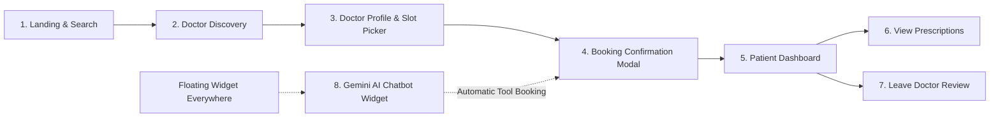

# 🖥️ Dr.Appoinment — Frontend Development & API Integration Guide

This guide provides an end-to-end blueprint for building a modern, responsive, and role-aware frontend (React / Next.js / Vue / Angular) that connects to the **Dr.Appoinment** Spring Boot 4 backend.

---

## 📑 Table of Contents
1. [Recommended Frontend Tech Stack](#-recommended-frontend-tech-stack)
2. [Project Setup & Directory Structure](#-project-setup--directory-structure)
3. [API Client & Authentication Architecture](#-api-client--authentication-architecture)
4. [Exhaustive Backend REST Endpoints Reference (49 Endpoints)](#-exhaustive-backend-rest-endpoints-reference)
   - [1. Authentication Module (`/api/auth`)](#1-authentication-module-apiauth)
   - [2. Patient Module (`/api/patients`)](#2-patient-module-apipatients)
   - [3. Department Module (`/api/departments`)](#3-department-module-apidepartments)
   - [4. Doctor Module (`/api/doctors`)](#4-doctor-module-apidoctors)
   - [5. Doctor Availability & Slots (`/api/doctors/{id}/availability`, `/slots`)](#5-doctor-availability--slots)
   - [6. Appointment Scheduling (`/api/appointments`)](#6-appointment-scheduling-apiappointments)
   - [7. Prescription Management (`/api/prescriptions`)](#7-prescription-management-apiprescriptions)
   - [8. Review & Rating Management (`/api/reviews`)](#8-review--rating-management-apireviews)
   - [9. AI Conversational Healthcare Chatbot (`/api/chat`)](#9-ai-conversational-healthcare-chatbot-apichat)
5. [Key UI Screens & User Flows](#-key-ui-screens--user-flows)
6. [AI Chatbot Widget Implementation Guide](#-ai-chatbot-widget-implementation-guide)
7. [Error Handling & Toast Notification Strategy](#-error-handling--toast-notification-strategy)

---

## 🛠️ Recommended Frontend Tech Stack

| Technology | Purpose | Recommended Version |
| :--- | :--- | :--- |
| **Next.js / React** | Framework & Component Model | Next.js 15+ (App Router) or React 19 |
| **TypeScript** | Type safety matching backend DTOs | TypeScript 5.5+ |
| **Tailwind CSS + shadcn/ui** | Rapid UI styling & pre-built accessible components | Tailwind v4 / shadcn |
| **Axios or TanStack Query** | HTTP requests, caching, and server-state sync | TanStack Query v5 + Axios |
| **Lucide React** | Clinical and navigation icons | Latest |
| **Zustand** | Lightweight client state (Auth token & User profile) | Zustand v5 |

---

## 📁 Project Setup & Directory Structure

```text
frontend/
├── src/
│   ├── api/                   # API clients and endpoint services
│   │   ├── client.ts          # Axios instance with JWT interceptors
│   │   ├── auth.ts            # Login, register, me
│   │   ├── doctors.ts         # Doctor search, profile, slots
│   │   ├── appointments.ts    # Booking, cancel, reschedule, status
│   │   ├── prescriptions.ts   # Prescriptions CRUD
│   │   ├── reviews.ts         # Reviews CRUD & doctor rating summaries
│   │   └── chat.ts            # Gemini AI chatbot endpoint
│   ├── components/            # Reusable UI widgets
│   │   ├── chat/              # DrAppoinment Floating AI Chat Widget
│   │   ├── doctors/           # DoctorCard, FilterBar, SlotPicker
│   │   ├── appointments/      # BookingModal, AppointmentTable
│   │   └── common/            # Navbar, Sidebar, ProtectedRoute, Toast
│   ├── hooks/                 # Custom React hooks (useAuth, useDoctors, useChat)
│   ├── types/                 # TypeScript interfaces mirroring Java DTOs
│   │   ├── auth.types.ts
│   │   ├── doctor.types.ts
│   │   ├── appointment.types.ts
│   │   └── chat.types.ts
│   └── app/ (or pages/)       # Application routes
│       ├── (auth)/login/
│       ├── (auth)/register/
│       ├── doctors/           # Doctor discovery & slot selection
│       ├── patient/           # Patient portal (bookings, history, prescriptions)
│       ├── doctor/            # Doctor portal (daily schedule, issue prescription)
│       └── admin/             # Admin portal (departments, doctor onboard)
```

---

## 🔐 API Client & Authentication Architecture

### 1. Axios Instance with Automatic JWT Interceptor (`src/api/client.ts`)

```typescript
import axios from 'axios';

const API_BASE_URL = process.env.NEXT_PUBLIC_API_URL || 'http://localhost:8080';

export const apiClient = axios.create({
  baseURL: API_BASE_URL,
  headers: {
    'Content-Type': 'application/json',
  },
});

// Request Interceptor: Automatically inject Bearer token
apiClient.interceptors.request.use((config) => {
  if (typeof window !== 'undefined') {
    const token = localStorage.getItem('dr_app_token');
    if (token) {
      config.headers.Authorization = `Bearer ${token}`;
    }
  }
  return config;
});

// Response Interceptor: Handle 401 Unauthorized globally
apiClient.interceptors.response.use(
  (response) => response,
  (error) => {
    if (error.response?.status === 401) {
      if (typeof window !== 'undefined') {
        localStorage.removeItem('dr_app_token');
        window.location.href = '/login';
      }
    }
    return Promise.reject(error);
  }
);
```

### 2. Global Auth Store (`src/store/useAuthStore.ts`)

```typescript
import { create } from 'zustand';

interface User {
  id: number;
  email: string;
  role: 'PATIENT' | 'DOCTOR' | 'RECEPTIONIST' | 'ADMIN';
  enabled: boolean;
}

interface AuthState {
  token: string | null;
  user: User | null;
  setAuth: (token: string, user: User) => void;
  logout: () => void;
}

export const useAuthStore = create<AuthState>((set) => ({
  token: typeof window !== 'undefined' ? localStorage.getItem('dr_app_token') : null,
  user: null,
  setAuth: (token, user) => {
    localStorage.setItem('dr_app_token', token);
    set({ token, user });
  },
  logout: () => {
    localStorage.removeItem('dr_app_token');
    set({ token: null, user: null });
  },
}));
```

---

## 📡 Exhaustive Backend REST Endpoints Reference

All endpoints run against base URL: `http://localhost:8080`.

### 1. Authentication Module (`/api/auth`)

| # | Method | Endpoint | Access | Request Body | Description |
|---|---|---|---|---|---|
| **1** | `POST` | `/api/auth/register` | Public | `{ email, password, role }` | Registers user account, returns JWT. Roles: `PATIENT`, `DOCTOR`, `RECEPTIONIST`, `ADMIN`. |
| **2** | `POST` | `/api/auth/login` | Public | `{ email, password }` | Authenticates credentials, returns 24-hour JWT Bearer token. |
| **3** | `GET` | `/api/auth/me` | Authenticated | *None* (Bearer Token) | Returns authenticated user profile (`id`, `email`, `role`, `enabled`). |

---

### 2. Patient Module (`/api/patients`)

| # | Method | Endpoint | Access | Request Body | Description |
|---|---|---|---|---|---|
| **4** | `POST` | `/api/patients` | Authenticated | `{ fullName, email, phoneNumber, age, gender }` | Creates new patient profile (email must be unique). |
| **5** | `GET` | `/api/patients` | Authenticated | *None* | Retrieves all patient records. |
| **6** | `GET` | `/api/patients/{id}` | Authenticated | *None* | Retrieves single patient profile by numeric ID. |
| **7** | `PUT` | `/api/patients/{id}` | Authenticated | `{ fullName, email, phoneNumber, age, gender }` | Updates existing patient profile. |
| **8** | `DELETE` | `/api/patients/{id}` | Admin / Receptionist | *None* | Deletes patient profile by ID. |

---

### 3. Department Module (`/api/departments`)

| # | Method | Endpoint | Access | Request Body | Description |
|---|---|---|---|---|---|
| **9** | `POST` | `/api/departments` | Admin | `{ name, description }` | Registers new hospital department (e.g. Cardiology). Name is unique. |
| **10** | `GET` | `/api/departments` | Public | *None* | Retrieves list of all hospital departments. |
| **11** | `GET` | `/api/departments/search?name={keyword}` | Public | *None* | Searches departments by case-insensitive name keyword. |
| **12** | `GET` | `/api/departments/{id}` | Public | *None* | Retrieves single department details by ID. |
| **13** | `PUT` | `/api/departments/{id}` | Admin | `{ name, description }` | Updates department name or description. |
| **14** | `DELETE` | `/api/departments/{id}` | Admin | *None* | Deletes department by ID. |

---

### 4. Doctor Module (`/api/doctors`)

| # | Method | Endpoint | Access | Query Params / Body | Description |
|---|---|---|---|---|---|
| **15** | `POST` | `/api/doctors` | Admin | `{ fullName, email, phoneNumber, gender, specialization, qualification, experienceYears, licenseNumber, consultationFee, about, profileImageUrl, departmentId }` | Registers new doctor profile linked to department. |
| **16** | `GET` | `/api/doctors` | Public | `page=0&size=10&sort=experienceYears,desc` | Retrieves paginated doctor listing. |
| **17** | `GET` | `/api/doctors/{id}` | Public | *None* | Retrieves full doctor profile by ID. |
| **18** | `GET` | `/api/doctors/department/{deptId}` | Public | *None* | Retrieves all doctors belonging to a department. |
| **19** | `GET` | `/api/doctors/search` | Public | `query`, `specialization`, `departmentId`, `minExperience`, `maxFee`, `page`, `size` | Multi-criteria dynamic doctor search & filtering. |
| **20** | `PUT` | `/api/doctors/{id}` | Admin / Doctor | Doctor request body | Updates doctor profile. |
| **21** | `DELETE` | `/api/doctors/{id}` | Admin | *None* | Deletes doctor profile. |

---

### 5. Doctor Availability & Slots (`/api/doctors/{id}/availability`, `/slots`)

| # | Method | Endpoint | Access | Query Params / Body | Description |
|---|---|---|---|---|---|
| **22** | `POST` | `/api/doctors/{doctorId}/availability` | Doctor / Admin | `{ dayOfWeek, startTime, endTime, slotDurationMinutes, isAvailable }` | Adds recurring weekly shift (e.g. MONDAY 09:00 to 13:00, 30 min slots). |
| **23** | `GET` | `/api/doctors/{doctorId}/availability` | Public | *None* | Retrieves all configured weekly shifts for a doctor. |
| **24** | `GET` | `/api/doctors/{doctorId}/slots` | Public | `date=YYYY-MM-DD` (e.g. `2026-11-25`) | **Dynamic Slot Generator**: Returns open booking intervals for target calendar date. |
| **25** | `PUT` | `/api/doctors/{doctorId}/availability/{id}` | Doctor / Admin | Availability request body | Updates a doctor's shift hours or availability flag. |
| **26** | `DELETE` | `/api/doctors/{doctorId}/availability/{id}` | Doctor / Admin | *None* | Removes a shift configuration. |

---

### 6. Appointment Scheduling (`/api/appointments`)

| # | Method | Endpoint | Access | Request Body / Params | Description |
|---|---|---|---|---|---|
| **27** | `POST` | `/api/appointments` | Patient / Staff | `{ patientId, doctorId, appointmentDate, startTime, reason, notes }` | **Books appointment**: Validates slots, past dates, double-booking, and snapshots fee. |
| **28** | `GET` | `/api/appointments/{id}` | Authenticated | *None* | Retrieves single appointment details. |
| **29** | `GET` | `/api/appointments/patient/{patientId}` | Authenticated | `page=0&size=10` | Retrieves paginated appointment history for a patient. |
| **30** | `GET` | `/api/appointments/doctor/{doctorId}` | Authenticated | `page=0&size=10` | Retrieves consultation schedule for a doctor. |
| **31** | `GET` | `/api/appointments/status/{status}` | Staff | `status` (`CONFIRMED`, `COMPLETED`, `CANCELLED`, etc.) | Filters appointments by lifecycle status. |
| **32** | `PATCH` | `/api/appointments/{id}/cancel` | Patient / Staff | `?reason=Reason+text` | Cancels an active appointment with reason. |
| **33** | `PATCH` | `/api/appointments/{id}/reschedule` | Patient / Staff | `{ appointmentDate, startTime, reason }` | Reschedules appointment to new date/time with slot revalidation. |
| **34** | `PATCH` | `/api/appointments/{id}/status` | Doctor / Staff | `{ status, notes }` | Updates status (`COMPLETED`, `REJECTED`, `NO_SHOW`). |

---

### 7. Prescription Management (`/api/prescriptions`)

| # | Method | Endpoint | Access | Request Body | Description |
|---|---|---|---|---|---|
| **35** | `POST` | `/api/prescriptions` | Doctor | `{ appointmentId, diagnosis, medicines, instructions }` | Issues prescription for a `COMPLETED` appointment (one per appointment). |
| **36** | `GET` | `/api/prescriptions/{id}` | Authenticated | *None* | Retrieves prescription by ID. |
| **37** | `GET` | `/api/prescriptions/appointment/{appointmentId}` | Authenticated | *None* | Retrieves prescription linked to an appointment ID. |
| **38** | `GET` | `/api/prescriptions/patient/{patientId}` | Authenticated | `page=0&size=10` | Retrieves paginated prescriptions for a patient. |
| **39** | `GET` | `/api/prescriptions/doctor/{doctorId}` | Authenticated | `page=0&size=10` | Retrieves paginated prescriptions issued by a doctor. |
| **40** | `PUT` | `/api/prescriptions/{id}` | Doctor | `{ appointmentId, diagnosis, medicines, instructions }` | Modifies prescription instructions or medicines. |

---

### 8. Review & Rating Management (`/api/reviews`)

| # | Method | Endpoint | Access | Request Body | Description |
|---|---|---|---|---|---|
| **41** | `POST` | `/api/reviews` | Patient | `{ appointmentId, rating, comment }` | Submits 1-to-5 star review for a `COMPLETED` consultation (one per appointment). |
| **42** | `GET` | `/api/reviews/{id}` | Public | *None* | Retrieves single review by ID. |
| **43** | `GET` | `/api/reviews/appointment/{appointmentId}` | Public | *None* | Retrieves review for an appointment. |
| **44** | `GET` | `/api/reviews/doctor/{doctorId}` | Public | `page=0&size=10` | Retrieves paginated reviews for a doctor. |
| **45** | `GET` | `/api/reviews/doctor/{doctorId}/summary` | Public | *None* | Returns real-time doctor rating metrics (`averageRating`, `totalReviews`). |
| **46** | `GET` | `/api/reviews/patient/{patientId}` | Authenticated | `page=0&size=10` | Retrieves reviews submitted by a patient. |
| **47** | `PUT` | `/api/reviews/{id}` | Patient | `{ rating, comment }` | Updates an existing review. |
| **48** | `DELETE` | `/api/reviews/{id}` | Patient / Admin | *None* | Deletes a review. |

---

### 9. AI Conversational Healthcare Chatbot (`/api/chat`)

| # | Method | Endpoint | Access | Request Body | Description |
|---|---|---|---|---|---|
| **49** | `POST` | `/api/chat` | Public / Patient | `{ message, conversationId }` | **Gemini AI Chat Assistant**: Maintains multi-turn context, triggers backend tools (`searchDoctors`, `checkDoctorAvailability`, `bookAppointment`), and enforces medical safety guardrails. |

---

## 📱 Key UI Screens & User Flows



### 1. Doctor Discovery & Interactive Slot Selection
- **Search Filters:** Keyword input, Department dropdown, Specialization pills, Consultation fee slider.
- **Calendar & Time Slot Grid:**
  1. User selects a doctor.
  2. Frontend queries `GET /api/doctors/{id}/slots?date=YYYY-MM-DD`.
  3. Displays available times as green clickable buttons (e.g. `10:00 AM`, `10:30 AM`).
  4. Clicking a slot opens the Booking Dialog.

### 2. Patient Dashboard
- **Upcoming Consultations:** Displays confirmed bookings with "Reschedule" and "Cancel" buttons.
- **Completed Consultations:** Shows "View Prescription" and "Rate Doctor (1-5 Stars)" action buttons.

---

## 🤖 AI Chatbot Widget Implementation Guide

Create a floating chat widget ([`DrAppoinmentChat.tsx`](#)) accessible across all pages:

```tsx
import React, { useState } from 'react';
import axios from 'axios';
import { MessageSquare, Send, X, Bot, User } from 'lucide-react';

interface ChatMessage {
  sender: 'user' | 'bot';
  text: string;
}

export function DrAppoinmentChat() {
  const [isOpen, setIsOpen] = useState(false);
  const [messages, setMessages] = useState<ChatMessage[]>([
    { sender: 'bot', text: 'Hello! I am Dr.Appoinment assistant. How can I help you find a doctor or book an appointment today?' }
  ]);
  const [input, setInput] = useState('');
  const [loading, setLoading] = useState(false);
  const [conversationId] = useState(() => 'sess_' + Math.random().toString(36).substring(2, 9));

  const sendMessage = async () => {
    if (!input.trim() || loading) return;

    const userText = input;
    setInput('');
    setMessages(prev => [...prev, { sender: 'user', text: userText }]);
    setLoading(true);

    try {
      const res = await axios.post('http://localhost:8080/api/chat', {
        message: userText,
        conversationId: conversationId
      });

      setMessages(prev => [...prev, { sender: 'bot', text: res.data.response }]);
    } catch (err) {
      setMessages(prev => [...prev, { sender: 'bot', text: 'Sorry, I am having trouble connecting to the hospital system.' }]);
    } finally {
      setLoading(false);
    }
  };

  return (
    <div className="fixed bottom-6 right-6 z-50">
      {!isOpen && (
        <button
          onClick={() => setIsOpen(true)}
          className="bg-teal-600 hover:bg-teal-700 text-white p-4 rounded-full shadow-lg transition flex items-center gap-2"
        >
          <Bot size={24} />
          <span className="font-medium text-sm">Ask AI Assistant</span>
        </button>
      )}

      {isOpen && (
        <div className="bg-white rounded-2xl shadow-2xl w-96 h-[500px] flex flex-col border border-gray-100 overflow-hidden">
          {/* Header */}
          <div className="bg-teal-600 text-white p-4 flex justify-between items-center">
            <div className="flex items-center gap-2">
              <Bot size={20} />
              <h3 className="font-semibold text-sm">Dr.Appoinment AI</h3>
            </div>
            <button onClick={() => setIsOpen(false)} className="hover:opacity-80">
              <X size={18} />
            </button>
          </div>

          {/* Messages */}
          <div className="flex-1 overflow-y-auto p-4 space-y-3 bg-gray-50">
            {messages.map((m, idx) => (
              <div key={idx} className={`flex ${m.sender === 'user' ? 'justify-end' : 'justify-start'}`}>
                <div className={`max-w-[80%] p-3 rounded-2xl text-sm ${
                  m.sender === 'user'
                    ? 'bg-teal-600 text-white rounded-br-none'
                    : 'bg-white text-gray-800 shadow-sm border border-gray-100 rounded-bl-none'
                }`}>
                  {m.text}
                </div>
              </div>
            ))}
            {loading && <div className="text-xs text-gray-400 italic">Dr.Appoinment assistant is typing...</div>}
          </div>

          {/* Input */}
          <div className="p-3 bg-white border-t flex gap-2">
            <input
              type="text"
              value={input}
              onChange={e => setInput(e.target.value)}
              onKeyDown={e => e.key === 'Enter' && sendMessage()}
              placeholder="Ask for doctors, slots, or bookings..."
              className="flex-1 border rounded-lg px-3 py-2 text-sm focus:outline-none focus:border-teal-600"
            />
            <button
              onClick={sendMessage}
              className="bg-teal-600 text-white p-2 rounded-lg hover:bg-teal-700 transition"
            >
              <Send size={18} />
            </button>
          </div>
        </div>
      )}
    </div>
  );
}
```

---

## ⚠️ Error Handling & Toast Notification Strategy

The backend returns standardized JSON error responses:

### 1. Handling Validation Errors (`400 Bad Request`)
When form inputs fail Jakarta Validation, the backend responds with:
```json
{
  "timestamp": "2026-11-16T15:10:00",
  "status": 400,
  "error": "Bad Request",
  "message": "Validation failed",
  "errors": {
    "email": "Invalid email format",
    "password": "Password must be between 6 and 50 characters"
  }
}
```
**Frontend Handling:** Extract `error.response.data.errors` and attach individual error messages beneath the matching form fields.

### 2. Handling Resource Conflicts (`409 Conflict`)
Triggered on duplicate email registrations or double-booking conflicts:
```json
{
  "timestamp": "2026-11-16T15:10:00",
  "status": 409,
  "error": "Conflict",
  "message": "Doctor already has a scheduled appointment in this time window"
}
```
**Frontend Handling:** Trigger a toast notification (e.g., `toast.error(error.response.data.message)`) prompting the user to select an alternate time slot.
